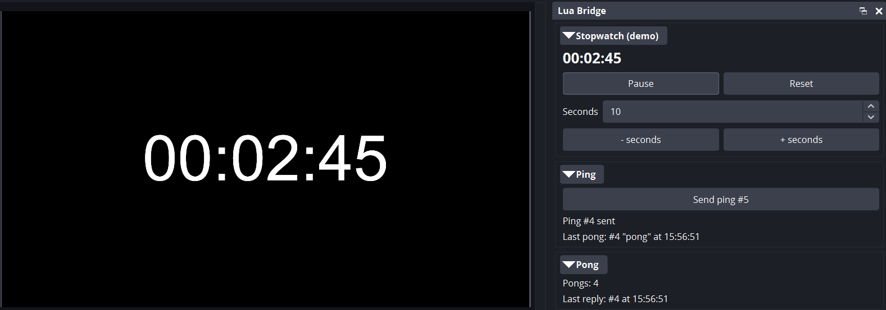

# Lua Bridge

> **Beta (0.9.0-beta2).** Feedback and bug reports are welcome: see [Reporting bugs](#reporting-bugs).

Lua Bridge is an independent plugin for OBS Studio and not a product of the OBS Project.

Lua Bridge gives your OBS Lua scripts what OBS's own scripting can't do:
- **Controls in a dock:** buttons, labels, number and text inputs, and toggles in **Docks → Lua Bridge**, or in a
  dock of its own for each script you choose (**Tools → Lua Bridge**).
- **Commands:** from that dock, from other scripts, or from obs-websocket 5 tools. Confirmed so far: Bitfocus Companion. See [control surfaces](docs/integrations/control-surfaces.md).
- **Live state and custom events** that other scripts and websocket clients can follow.

Scripts written for it keep working when the plugin isn't installed: they simply run without the dock.

## Install
Requires **OBS Studio 31.1 or newer**. Download the file for your system from
[Releases](https://github.com/midnight-studios/obs-lua-bridge/releases); full steps and uninstalling are in
[docs/INSTALL.md](docs/INSTALL.md).

**OBS 33:** its Plugin Manager labels Lua Bridge "Legacy" because of where it's installed. It still loads and
works; the install layout will move once the official OBS plugin template supports the new one
([FAQ](docs/INSTALL.md#faq)).

**Windows:**
1. Close OBS.
2. Open `obs-lua-bridge-<version>-windows-x64.zip`.
3. Copy the `obs-lua-bridge` folder into `C:\ProgramData\obs-studio\plugins\`.
4. Start OBS.

**macOS (Apple Silicon and Intel).** This beta is **not signed or notarized by Apple**, so macOS asks you to approve it once:
1. Close OBS.
2. Open `obs-lua-bridge-<version>-macos-universal.pkg`. macOS says it can't verify it; click **Done**.
3. Go to **System Settings → Privacy & Security** and click **Open Anyway** next to the message about the package.
4. Run the installer. It installs into your user Library.
5. Start OBS.

The `.tar.xz` is a manual alternative; see [INSTALL.md](docs/INSTALL.md#macos).

**Linux:**
- **Ubuntu 24.04:** `sudo apt install ./obs-lua-bridge-<version>-x86_64-linux-gnu.deb`.
- **Other distributions:** use the `.tar.xz`; see [INSTALL.md](docs/INSTALL.md#linux).

## Quick start (5 minutes)
1. Install the plugin, start OBS, and open **Docks → Lua Bridge**. It says no scripts are registered yet.
2. Open **Tools → Scripts**, click **+**, and pick `hello-bridge.lua` from the plugin's `lua/examples/` folder:
   - **Windows:** `C:\ProgramData\obs-studio\plugins\obs-lua-bridge\data\lua\examples\`
   - **macOS:** `~/Library/Application Support/obs-studio/plugins/obs-lua-bridge.plugin/Contents/Resources/lua/examples/`
     (in the file picker, press **Cmd+Shift+G** and paste the path)
   - **Linux (.deb):** `/usr/share/obs/obs-plugins/obs-lua-bridge/lua/examples/`
3. A **Hello Bridge** section appears in the dock. Click **Ping**: "Last ping" shows the time, and the Script Log
   (Tools → Scripts → Script Log) says `ping received`.
4. **Your own script:**
   1. copy `luabridge.lua`, from the same `lua/` folder, next to your script;
   2. load it with `local bridge = dofile(script_path() .. "luabridge.lua")`;
   3. register your controls. `hello-bridge.lua` is a 50-line template to start from.

## Examples
They ship with the plugin in `lua/examples/`, and are also available on their own as `obs-lua-bridge-lua-<version>.zip`:
- **hello-bridge**: the smallest example, a Ping button and a label.
- **scoreboard**: a score board with +/- buttons that also sends a `score.changed` event.
- **stopwatch-demo**: a stopwatch controlled from the dock, shown in a text source.
- **ping-pong**: two scripts talking to each other, with commands one way and events back.

## Using a Stream Deck
Use [Bitfocus Companion](https://bitfocus.io/companion). It drives Stream Deck hardware directly, and its OBS
module can send Lua Bridge commands ("Custom – Send Vendor Request").
- **Quit Elgato's Stream Deck app first.** Companion's guide recommends connecting Stream Decks without the
  Elgato software ([source](https://companion.free/user-guide/v4.2/surfaces/elgato-streamdeck/)).
- **Setup:** [control surfaces](docs/integrations/control-surfaces.md#using-a-stream-deck).

## Learn more
- [docs/API.md](docs/API.md): the script API, dock controls, the helper library and the obs-websocket requests.
- [docs/INSTALL.md](docs/INSTALL.md): install and uninstall on every platform.
- [lua/README.txt](lua/README.txt): the helper and the examples.
- [docs/integrations/control-surfaces.md](docs/integrations/control-surfaces.md): sending commands from control surfaces. Companion is confirmed; others are being checked.
- [CHANGELOG.md](CHANGELOG.md): what's new. [CONTRIBUTING.md](CONTRIBUTING.md): building and testing.

## AI usage
Lua Bridge was developed with extensive help from an AI coding assistant, Anthropic's Claude (through Claude
Code). Every change by a person since the repository was created from the OBS plugin template was made with it;
those commits carry a `Co-Authored-By: Claude` line.
- **Design:** the specification and the script API were worked out with Claude. The maintainer set the goals and
  made the design decisions.
- **Code:** Claude wrote most of the plugin (C++), the Lua helper and examples, and the build, packaging and CI
  scripts, following the maintainer's instructions.
- **Tests:** Claude wrote the unit tests, websocket test suites, fuzzers and stress tests, and ran them against
  test copies of OBS.
- **Docs:** Claude drafted most of the documentation; the maintainer edited it.

**The maintainer's role:** the maintainer defined the goals, made every design decision, reviewed every change
report and pull request before merging, and tested the plugin in OBS on Windows.

**Review and testing:** CI builds on Windows, macOS and Ubuntu and runs the unit tests on every pull request, and
changes merge only when CI passes. Before the first beta (0.9.0-beta1), the plugin was also tested on Windows
with fuzzing, a 1-hour stress test, an 8-hour soak, shutdowns with commands in flight, and scene collection and
profile switching; those runs haven't been repeated for 0.9.0-beta2. It hasn't been tested on a real Mac yet.

## Reporting bugs
[Open an issue](https://github.com/midnight-studios/obs-lua-bridge/issues/new/choose) on GitHub. The bug report
form asks for:
- your **OBS version** (Help → About) and **operating system**;
- the **Lua Bridge version**, from the OBS log line `[lua-bridge] plugin loaded successfully (version …)`;
- **your OBS log file:** in OBS, **Help → Log Files → Upload Current Log File**, and paste the link (or attach
  the file);
- what you did, what happened, and which scripts were loaded. A minimal script that shows the problem helps a lot.

Security problems: please report them privately, as [SECURITY.md](SECURITY.md) describes, not as issues.

## License
- **Source code:** all of it is in this repository, and every release also attaches the complete source as
  `obs-lua-bridge-<version>-source.tar.xz`.
- **The plugin:** [GPL-2.0-or-later](LICENSE).
- **The Lua helper and examples in [lua/](lua/):** [MIT](lua/LICENSE), so you can copy `luabridge.lua` into scripts under any license.
- **Third-party notices:** [THIRD-PARTY-NOTICES.md](THIRD-PARTY-NOTICES.md).
- **Security:** see [SECURITY.md](SECURITY.md).
